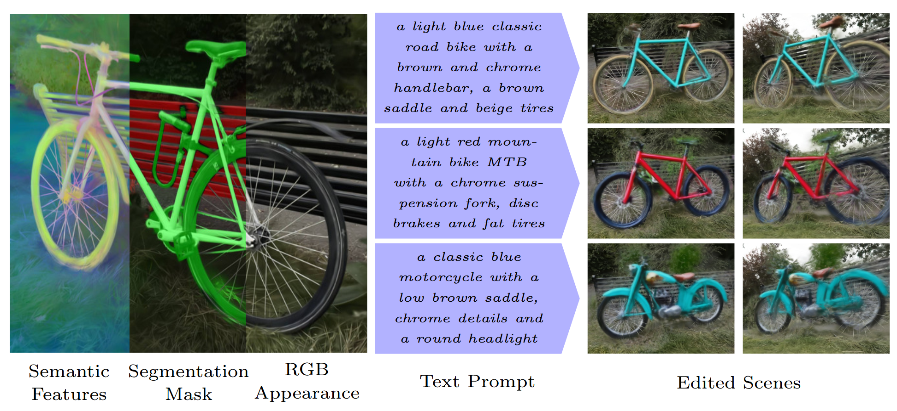

# TASE: Truncation-Aware Semantic Embeddings for 3D Scene Understanding and Editing - ECCV 2026

This is the companion code for the paper [TASE: Truncation-Aware Semantic Embeddings for 3D Scene Understanding and Editing](https://arxiv.org/abs/2606.03314) by Tim-Felix Faasch et. al. The code allows users to reproduce and extend the results reported in the paper. Please cite the above paper when reporting, reproducing or extending the results.

## Purpose of the project



> *Abstract:* High-fidelity semantic 3D scene representations are crucial for numerous applications, including robotics, autonomous driving, and simulation. Beyond this, the ability to edit such representations enables developers to adapt these applications more easily to specific target scenarios. Current approaches provide limited support for controllable editing. We introduce TASE, a method that projects pretrained 2D semantic features into a truncation-aware embedding space to enable flexible 3D scene editing. Our method explicitly optimizes a feature space in which progressively reducing feature channels yields increasingly abstract semantic representations, while retaining more channels preserves fine-grained detail. Additionally, we improve multi-view consistency of the features using a scale- and translation-equivariance loss. The resulting truncation-aware embedding space enables text-driven edits to 3D scenes, providing explicit control over how strongly edits adhere to the original scene content and allowing more substantial modifications than prior methods. Moreover, we propose a finetuning stage for the editing diffusion model to mitigate artifacts caused by geometric changes. Experimental results demonstrate competitive performance in 3D scene editing, substantially outperforming prior methods on edits involving large geometric modifications.

This software is a research prototype, solely developed for and published as part of the publication [TASE: Truncation-Aware Semantic Embeddings for 3D Scene Understanding and Editing](https://arxiv.org/abs/2606.03314). It will neither be maintained nor monitored in any way.


## Installation

Peak VRAM usage is about 68 GB during editing. Tested on NVIDIA A100 (80 GB), H200, and B200 with CUDA 13.0.

**Prerequisites**
- [uv](https://github.com/astral-sh/uv) package manager
- Python 3.12
- CUDA driver ≥ 13.0 and `nvcc` ≥ 13.0 (system-level or via the nvidia-cuda-nvcc pip package)

Clone the repository, create and activate the environment. `torch`, `torchvision`, and
`xformers` are pinned in `pyproject.toml` to be resolved from the CUDA 13.0 PyTorch
wheel index (`https://download.pytorch.org/whl/cu130`) so `xformers` matches the
CUDA 13 build of `torch`.

Install nerfstudio without its dependencies (they conflict with ours):

```bash
uv pip install nerfstudio==1.1.5 --no-deps
```

Install pytorch3d and fused-ssim without build isolation (they require torch to be
importable at build time).  Set `CUDA_ARCHITECTURES` so fused-ssim includes kernels, e.g. 8.0 and 10.0 for A100 and B200 GPUs:

```bash
CUDA_ARCHITECTURES="80;100" uv pip install --no-deps --no-build-isolation --no-cache \
  git+https://github.com/rahul-goel/fused-ssim

TORCH_CUDA_ARCH_LIST="8.0;10.0" uv pip install --no-deps --no-build-isolation \
  git+https://github.com/facebookresearch/pytorch3d.git@v0.7.9
```

Install the TASE package and point it to the repository root:

```bash
uv pip install -e .
export TASE_ROOT="$(pwd)"
```

> **Note:** `TASE_ROOT` must be set before running any TASE scripts.  Add the
> export to your shell profile or activate script to make it permanent.

## Quickstart


### Dataset conversion

Convert one or more COLMAP/LLFF scenes to the TASE format and extract
per-image semantic feature maps. Requires a trained MRL adapter checkpoint
(see *Model training* below):

```bash
bash scripts/convert_dataset.sh \
    --scenes bicycle garden counter \
    --source-subdir <YOUR DATA DIR> \
    --mrl-ckpt "WEIGHTS/mrl_adapter/epoch_1.pth"
```

The converted dataset is written to `DATA/TASE_360/_WEIGHTS`.

### Reconstruction

Train a 3DGS scene with TASE features from a converted dataset:

```bash
bash scripts/reconstruct.sh \
    --scenes bicycle garden counter \
    --dataset-subdir TASE_360/_WEIGHTS \
    --name my_run
```

Results are written to `$TASE_ROOT/OUTPUT/reconstruction/<name>/<scene>/`.

> **Note:** If this is the first time that you are using gsplat in this virtual environment, 
> gsplat will first compile C++ / Cuda extentions for accellerated rendering. 
> This can take several minutes and will delay the start of the training. 

### Viewing

Launch the interactive viewer for a reconstructed scene:

```bash
source .venv/bin/activate
python TASE/splatting/viewer_main.py \
  --ckpt <path to checkpoint .pt>
```

The viewer opens at `http://localhost:8080` by default. The training will also launch a viewer so that you can inspect the scene while it is being optimized. 

### Segmentation

Launch the viewer with the segmentation pane activated. 

```bash
source .venv/bin/activate
python TASE/splatting/viewer_main.py \
  --ckpt <path to checkpoint .pt> \
  --segmentation
```

Add positive and negative anchors until the target object is mostly covered (green) and very few gaussians outside the object are selected. Then hit `Refine Seg`

### Editing

The quickest way to run a preset edit end-to-end is via the provided script:

```bash
bash scripts/run_single_edit.sh <YOUR EDIT CONFIG>
```

Browse the TASE/splatting/config directory for predefined presets which correspond to the examples in the paper. Use a config subdir (e.g. bike_edits) to run the edits for all configs in that subdir. To run all presets for the paper experiments use:

```bash
bash scripts/run_all_edits.sh 
```

Both scripts require the WEIGHTS directory to be populated with the model
checkpoints. See *Model checkpoints* below. Optimized Gaussians with TASE 
features are also required, edit the config files to specify your checkpoint. 
Local edits also require a segmentation file, the location of which is also
specified in the config.

> **Note:** Configs have a nested design. The editor first loads `configs/base_parameters.json`. When a config subdir is specified, the first file to be loaded will be `configs/<subdir>/0_param_adjust.json` and then all other config files in alphabetic order. This allows to separate general config values, scene specific adjustments and editing prompts. 

You can alternatively run the viewer with interactive editing enabled: 

```bash 
source .venv/bin/activate
python TASE/splatting/editor_main.py \
    --new-dataset OUTPUT/editing/ \
    --mrl-model-path WEIGHTS/mrl_adapter/epoch_1.pth \
    --ctrl-net-path WEIGHTS/ctrlnet/spltctrl/diffusion_pytorch_model.safetensors \
    --transformer-path WEIGHTS/transformer/diffusion_pytorch_model.safetensors \
    --runner-config tase_edit_local.yml \
    --preset /fs/scratch/rb_bd_dlp_rng-dl01_cr_AIQ_employees/fat2hi/Workspace/Repos/TASE/TASE/splatting/configs/bike_edits \
    --keep-alive 
```

Use the GUI to load presets scenes or segmentation files, and to adjust editing parameters. 

### Model checkpoints

<!-- TODO: add download links when checkpoints are published -->
Place the downloaded checkpoints under:

```
WEIGHTS/
  mrl_adapter/epoch_1.pth                               # MRL adapter (AERoPE)
  stats/epoch_1_stats_diag_N50000.pt                    # The statistical distribution of the MRL features for supervision during 3DGS optimization
  ctrlnet/spltctrl/diffusion_pytorch_model.safetensors  # FLUX ControlNet for MRL features
  transformer/diffusion_pytorch_model.safetensors       # difix finetuned FLUX transformer (optional)
```

> **Note:** Pretriained checkpoints are not yet publicly available. Please use the model training described below and copy the resulting checkpoints to the WEIGHTS directory.

### Model training

To train the TASE feature space adapter and the ControlNet, you need the
ImageNet-1k dataset.  Download it from [imagenet.org](https://image-net.org/)
and set:

```bash
export IMGNET_ROOT=<path to ImageNet ILSVRC2012 images root>
```

**Stage 0 — MRL adapter (AERoPE)**

Train the feature-space adapter that compresses DINOv3 patch features to a
compact MRL embedding space:

```bash
bash scripts/train_mrl_adapter.sh \
    --max-dims 64 
```

The checkpoint is saved to `OUTPUT/models/MRL/dinov3/<run_id>/ckpt/epoch_1.pth`.
Copy or symlink it to `WEIGHTS/mrl_adapter/epoch_1.pth` for use by other scripts.

**Stage 1 — ControlNet on ImageNet**

Train the FLUX ControlNet conditioned on MRL-compressed DINOv3 features:

```bash
# Single GPU (H200 / B200):
bash scripts/train_controlnet.sh \
    --mrl-ckpt WEIGHTS/mrl_adapter/epoch_1.pth \
    --stages 512,4,1281167

# Single GPU (A100, 80 GB) — reduce batch size to 2:
bash scripts/train_controlnet.sh \
    --mrl-ckpt WEIGHTS/mrl_adapter/epoch_1.pth \
    --stages 512,2,1281167

# Multi-GPU:
bash scripts/train_controlnet.sh \
    --mrl-ckpt WEIGHTS/mrl_adapter/epoch_1.pth \
    --stages 512,4,1281167 \
    --multi-gpu
```

Checkpoints are saved to `OUTPUT/ControlNet/<run_id>/ckpts/`.

**Stage 2 — SplatCtrl dataset (artifact-fixing finetuning data)**

This stage builds the (corrupted-splat, clean-image, feature-map) training
triplets used to adapt the ControlNet to rendered Gaussian splat images.  It
requires [AnySplat](https://github.com/InternRobotics/AnySplat) (separate
environment recommended):

```bash
export ANYSPLAT_ROOT=<path to AnySplat repo>
bash scripts/build_splatctrl_dataset.sh \
    --mrl-ckpt WEIGHTS/mrl_adapter/epoch_1.pth \
    --num-samples 50000
```

The dataset is written to `DATA/SplatCtrl/train/<timestamp>/`.

**Stage 3 — SplatCtrl finetuning**

Finetune the Stage-1 ControlNet (and jointly the FLUX transformer) on the
SplatCtrl dataset:

```bash
# Single GPU:
bash scripts/finetune_controlnet.sh \
    --ctrlnet-ckpt OUTPUT/ControlNet/<run_id>/ckpts/controlnet_final_stage_1_res_512/diffusion_pytorch_model.safetensors \
    --dataset-root DATA/SplatCtrl/train/<timestamp>

# Multi-GPU:
bash scripts/finetune_controlnet.sh \
    --ctrlnet-ckpt OUTPUT/ControlNet/<run_id>/ckpts/controlnet_final_stage_1_res_512/diffusion_pytorch_model.safetensors \
    --dataset-root DATA/SplatCtrl/train/<timestamp> \
    --multi-gpu
```

Finetuned checkpoints are saved to `OUTPUT/ControlNet/splat_finetune/<run_id>/ckpts/`.

## License

TASE is open-sourced under the AGPL-3.0 license. See the LICENSE file for details.

For a list of other open source components included in PROJECT-NAME, see the file 3rd-party-licenses.txt.

## Citation

```
@InProceedings{Faasch2026_TASE,
    author="Faasch, Tim-Felix
    and Kall, Jochen
    and Nunes, Lucas
    and Behley, Jens
    and Stachniss, Cyrill",
    booktitle="Proc.~of the Europ.~Conf.~on Computer Vision (ECCV)",
    title="TASE: Truncation-Aware Semantic Embeddings for 3D Scene Understanding and Editing",
    year="2026"
}
```